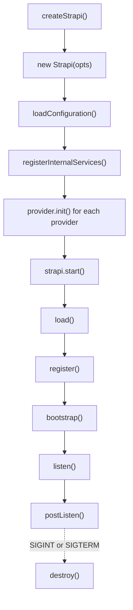

This page describes the boot sequence of the server runtime in `@strapi/core`. Read it before you add code to an internal provider, a loader, or a `register` or `bootstrap` function.

## Phases at a glance

Three kinds of participants receive lifecycle calls:

1. **Internal providers.** `Strapi` calls them directly, in the order of the `providers` array.
2. **Modules.** Each plugin and each API is a module. `Strapi` calls them through the `modules` registry.
3. **The application.** The loader imports `dist/src/index.js` into `strapi.app`. `Strapi` calls its `register`, `bootstrap` and `destroy` functions if they exist.

## Construction

`createStrapi(options)` resolves the application and dist directories and calls `new Strapi(...)`. Then it attaches the signal handlers (`destroyOnSignal`) and assigns the instance to `global.strapi`.

The constructor does three things, in this order:

1. It loads the configuration into `strapi.internal_config`.
2. It calls `registerInternalServices()`. This adds the core services to the container, for example `config`, `logger`, `server`, `eventHub`, `documents` and `db`. Most entries are factories. The container calls a factory on the first `get`. For example, the container creates the `Database` instance on the first access to `strapi.db`.
3. It calls `provider.init?.(strapi)` for each internal provider. `init` is synchronous.

Construction does not read plugins, APIs or content types.

## Internal providers

A provider is an object with optional `init`, `register`, `bootstrap` and `destroy` functions. The `providers` array sets the call order for every phase.

| Order | Provider           | `init`                                                                       | `register`                                                                                                                                                                                    | `bootstrap`                                                                                | `destroy`                                                                  |
| ----- | ------------------ | ---------------------------------------------------------------------------- | --------------------------------------------------------------------------------------------------------------------------------------------------------------------------------------------- | ------------------------------------------------------------------------------------------ | -------------------------------------------------------------------------- |
| 1     | `registries`       | Adds the 14 registries to the container.                                     | Runs `loadApplicationContext()`. Creates the two content-type sync hooks, adds core handlers to them, and creates the `strapi::app.afterBootstrap` hook. Adds an internal database migration. |                                                                                            |                                                                            |
| 2     | `admin`            | Adds `admin`, a factory that requires `@strapi/admin/strapi-server`.         | Loads admin artifacts under `admin::`, then calls the admin `register`.                                                                                                                       | Calls the admin `bootstrap`.                                                               | Calls the admin `destroy` only if this instance loaded the admin services. |
| 3     | `ai`               | Adds `ai`.                                                                   |                                                                                                                                                                                               |                                                                                            |                                                                            |
| 4     | `contentStructure` | Adds `content-structure`.                                                    |                                                                                                                                                                                               | Validates the groups file and logs the group count.                                        |                                                                            |
| 5     | `coreStore`        | Adds the core store model to the `models` registry. Adds `coreStore`.        |                                                                                                                                                                                               |                                                                                            |                                                                            |
| 6     | `sessionManager`   | Adds `sessionManager`.                                                       |                                                                                                                                                                                               | Throws if `admin.auth.secret` is missing, unless `admin.serveAdminPanel` is `false`.       |                                                                            |
| 7     | `webhooks`         | Adds the webhook model to `models`. Adds `webhookStore` and `webhookRunner`. |                                                                                                                                                                                               | Reads the webhooks from the database and adds each one to the runner.                      |                                                                            |
| 8     | `telemetry`        | Adds `telemetry`.                                                            | Calls `telemetry.register()`.                                                                                                                                                                 | Calls `telemetry.bootstrap()`.                                                             | Calls `telemetry.destroy()`.                                               |
| 9     | `cron`             | Adds `cron`.                                                                 |                                                                                                                                                                                               | Adds `server.cron.tasks` if `server.cron.enabled` is not `false`. Starts the cron service. | Calls `cron.destroy()`.                                                    |
| 10    | `mcp`              | Adds `ai.mcp`.                                                               |                                                                                                                                                                                               | Starts the MCP server if it is enabled. Logs errors and does not throw.                    | Stops the MCP server if it runs.                                           |

The order has effects. `coreStore` and `webhooks` call `strapi.get('models')` in `init`. This works only because `registries` is first in the array.

## Register phase

`strapi.register()` runs these steps:

1. `strapi.ee.init(...)` initializes the Enterprise Edition helper.
2. Each provider runs `register`, in array order. The `registries` provider runs the loaders. The `admin` provider loads the admin artifacts and runs the admin `register`.
3. `strapi.get('modules').register()` runs the `register` function of each module, one after the other, in insertion order.
4. `strapi.app.register({ strapi })` runs, if the application defines it.
5. `convertCustomFieldType()` replaces each custom field attribute type with its underlying type.

At the end of this phase, the registries are full. The database is not ready. `strapi.db` exists, but it has no models. `strapi.db.query(uid)` throws `Model <uid> not found`. The HTTP routes do not exist yet.

### Loaders

`loadApplicationContext()` starts eight loaders with `Promise.all`:

| Loader        | Reads                                                                           | Writes to                                                                          |
| ------------- | ------------------------------------------------------------------------------- | ---------------------------------------------------------------------------------- |
| `src-index`   | `dist/src/index.js`. Only `register`, `bootstrap` and `destroy` keys are valid. | `strapi.app`                                                                       |
| `sanitizers`  | Nothing                                                                         | `sanitizers` registry: empty `content-api` lists for `input`, `output` and `query` |
| `validators`  | Nothing                                                                         | `validators` registry: empty `content-api` lists for `input` and `query`           |
| `plugins`     | Enabled plugins, `config/plugins.js`, `src/extensions`                          | `plugins` registry, which creates `plugin::<name>` modules                         |
| `apis`        | `dist/src/api/*`                                                                | `apis` registry, which creates `api::<name>` modules                               |
| `components`  | `dist/src/components/<category>/<name>.json`                                    | `components` registry, with UID `<category>.<name>`                                |
| `middlewares` | `dist/src/middlewares/*.js` and the internal middlewares                        | `middlewares` registry, under `global::` and `strapi::`                            |
| `policies`    | `dist/src/policies/*.js`                                                        | `policies` registry, under `global::`                                              |

When the `plugins` and `apis` loaders add a module, the `modules` registry creates it and calls `module.load()` at once. `load()` adds the module content types, services, policies, middlewares and controllers to their registries under the module namespace. It also stores the module config under the namespace. Routes stay on the module object. `server.initRouting()` reads them in the bootstrap phase. See [Module routes by phase](#module-routes-by-phase).

:::caution
The loaders run at the same time. Each loader awaits file-system calls before it adds entries. The `plugins` and `apis` loaders add modules to the same `modules` registry, and the code does not set an order between them. The `modules` registry runs `register`, `bootstrap` and `destroy` in insertion order. Do not write a plugin that must run before or after an API module.
:::

All loaders finish before the first module `register` runs. Thus, in `register`, a plugin can read all content types, from plugins and from APIs. The i18n plugin uses this: its `register` adds the `locale` and `localizations` attributes to every content type.

The `admin` `register` runs before any plugin or API `register`, because providers run before modules.

## Bootstrap phase

`strapi.bootstrap()` runs these steps:

1. It configures the global HTTP proxy from `server.proxy`.
2. It builds the database models from all content types and components, plus the entries of the `models` registry.
3. It calls `strapi.db.init({ models })`.
4. It reads the previous content-type schemas from the core store, if the core store table exists.
5. It calls the `strapi::content-types.beforeSync` hook with `{ oldContentTypes, contentTypes }`.
6. It calls `strapi.db.schema.sync()`. If the schema changed, it removes orphan morph types.
7. It runs a one-time repair of unidirectional join tables. A core store flag records that the repair ran.
8. On Enterprise Edition, it checks the license.
9. It calls the `strapi::content-types.afterSync` hook.
10. It saves the current content-type schemas in the core store.
11. It calls `server.initMiddlewares()` and `server.initRouting()`.
12. It registers the Content API permission actions.
13. It runs the `bootstrap` function of each module.
14. It runs the `bootstrap` function of each provider.
15. It runs `strapi.app.bootstrap({ strapi })`, if the application defines it.
16. It calls the `strapi::app.afterBootstrap` hook. The admin uses it to lock the action provider, reset the super admin permissions and delete the stored permissions whose action is not registered.

:::note
The sync hooks run in steps 5 and 9, before module `bootstrap`. Add sync hook handlers in `register`. A handler that a module adds in `bootstrap` does not run during the current boot.
:::

Module `bootstrap` runs before provider `bootstrap`. Thus, when a plugin `bootstrap` runs, the webhook runner has not read the stored webhooks, the cron service has not started, and the admin `bootstrap` has not run.

## Start and listen

`strapi.start()` calls `load()` if `strapi.isLoaded` is `false`. Then it calls `listen()`. `listen()` uses `server.socket` if it is set. Otherwise it uses `server.host` and `server.port`.

`load()` sets `isLoaded` to `true` after `bootstrap()` returns. Thus `isLoaded` is `false` in every `register` and `bootstrap` function and in the `strapi::app.afterBootstrap` handlers. A process that calls only `register()`, such as `strapi services:list` or `strapi ts:generate-types`, never sets it.

`server.listen()` calls `server.mount()` if it did not run yet. `mount()` attaches the content API and admin routers to the root router and adds the root router to the Koa app. Thus a process that only calls `load()`, such as `strapi admin:create-user` or a script, has no API route on the root router. `strapi routes:list` calls `server.mount()` itself. See [Routers and route registration](./06-http-request-path.md#routers-and-route-registration).

After the server listens, `postListen()` logs the startup message and sends the `didStartServer` telemetry event without awaiting it. In development, `openAdmin()` opens the admin panel in a browser. Without `strapi develop --open` or `--no-open`, it opens only when no admin user exists and `admin.autoOpen` is not `false`. `--open` opens it when the first worker starts. Workers forked after a reload use the default behaviour, so once an admin user exists a reload opens no new tab, while a restart with no admin user still opens one. A worker that failed before its server listened does not count as a start, and the worker that replaces it keeps `--open`. `--no-open` never opens it, including on restarts. The flag reaches `openAdmin()` through the `open` option of `createStrapi()`, not through the app config. The Vite dev server runs in middleware mode, so it never opens a browser.

If `start()` catches an error, it calls `stopWithError()`. This logs the error and calls `stop()`. `stop()` calls `destroy()` without awaiting it, sends `stop` to the parent process when `autoReload` is on, and calls `process.exit(1)`.

## Destroy phase

`strapi.destroy()` runs these steps:

1. The `destroy` function of each module.
2. The `destroy` function of each provider.
3. `strapi.app.destroy({ strapi })`, if the application defines it.
4. `server.destroy()`.
5. `eventHub.destroy()`, which removes all listeners and subscribers.
6. `db.destroy()`.
7. `process.removeAllListeners()`.
8. `delete global.strapi`. This lets a test create a new instance.
9. The shutdown message is logged. The service container stays registered. API tests keep the instance, and the test helper clears the container after `destroy()` succeeds so the process can collect those services.

A second `destroy()` waits for the shutdown already in progress. After that shutdown succeeds, another `destroy()` returns immediately. If shutdown throws, a later `destroy()` continues from the step that failed, so a closed database is not skipped. `destroyOnSignal` calls `destroy()` on the first `SIGTERM` or `SIGINT` and then calls `process.exit()`. It ignores the next signals.

`strapi develop` also calls `destroy()` in its worker when a step fails after `load()`, for example a TypeScript compile error. The worker stays alive and keeps watching files, with two exceptions. If that `destroy()` throws, the worker sends `stop` to the primary and exits with code 1. A failure in `start()` never reaches this path, because develop does not await `start()`: `start()` calls `stopWithError()` itself. If `destroy()` throws during a restart, the worker sends neither `killed` nor `stop` and does not exit by itself: what happens next depends on how the process handles the unhandled rejection. Step 7 removed the `disconnect` listener that the `node:cluster` module adds to make a worker exit when its primary goes away, so develop adds it back. See [develop](../packages/core/strapi/commands/02-develop.md).

`destroy()` can run on an instance that did not finish `load()`. For example, `strapi build` and `strapi develop --no-watch-admin` create an instance only to read the configuration, and a signal can arrive during `load()`. A provider `destroy` must not assume that its `register` ran.

## Module routes by phase

The `routes` member of a plugin, an API or the admin changes shape in `server.initRouting()` (bootstrap step 11):

| Module                     | Until `initRouting()`                                                                                      | After `initRouting()`                                                                                                                       |
| -------------------------- | ---------------------------------------------------------------------------------------------------------- | ------------------------------------------------------------------------------------------------------------------------------------------- |
| Plugin with a router map   | As declared: each entry is a router object or a factory. Core plugins use factories that expose `.routes`. | A new map of built routers. Strapi calls each factory once with `{ strapi }`. Router objects are kept and get `type` and `prefix` defaults. |
| Plugin with a routes array | The array.                                                                                                 | The same array.                                                                                                                             |
| Plugin without routes      | `[]`. All plugins without routes share one array instance.                                                 | The same shared array.                                                                                                                      |
| API                        | A map keyed by file name in `routes/`, or `[]` without a `routes/` folder.                                 | A new map of built routers, all with `type: 'content-api'`. `[]` becomes `{}`.                                                              |
| Admin                      | As declared by `@strapi/admin`.                                                                            | A new map of built routers.                                                                                                                 |

`initRouting()` also sets `route.info` (`{ pluginName }` or `{ apiName }`) on each route, and the route manager adds `info.type`. A route added to a module after `initRouting()` has no `info` and is never served.

A router from `createCoreRouter()` builds its route list on the first read of `.routes`, from the content type at that moment. A read in a `register` function freezes the routes before other plugins extend the content type.

## Registry maps

`strapi.services`, `strapi.controllers`, `strapi.contentTypes`, `strapi.policies`, `strapi.middlewares` and `strapi.hooks` return a new object on each read. So do the `contentTypes`, `services`, `controllers`, `policies` and `middlewares` members of a module. A write to such an object is lost. On `strapi.services` and `strapi.controllers`, a write to an existing key throws `TypeError`, because each key is a getter. Use the registry methods instead, for example `strapi.get('services').set(uid, service)` or `strapi.get('content-types').extend(uid, fn)`.

`strapi.plugins`, `strapi.apis` and `strapi.components` return the registry's own object. A write there persists, but it skips the checks of `add()`.

## When an API works

The steps refer to the [register](#register-phase) and [bootstrap](#bootstrap-phase) lists above.

### Ready from

| API                                                                                          | Ready from                                                        | Before                                                                   |
| -------------------------------------------------------------------------------------------- | ----------------------------------------------------------------- | ------------------------------------------------------------------------ |
| `strapi.plugin(name)`, `strapi.api(name)`, `strapi.config.get('plugin::<name>')`             | The loaders, in the `registries` provider `register`              | `undefined`                                                              |
| `strapi.hook()` for the sync hooks and `strapi::app.afterBootstrap`                          | The `registries` provider `register`, after the loaders           | `undefined`                                                              |
| `strapi.plugin('upload').provider`                                                           | The upload plugin `register`                                      | `undefined`                                                              |
| `strapi.plugin('email').provider`                                                            | The email plugin `bootstrap`                                      | `undefined`                                                              |
| Custom field attributes with their underlying type                                           | End of the register phase (`convertCustomFieldType()`)            | `type: 'customField'`                                                    |
| `strapi.db.query()`, `strapi.documents(uid)` methods, `strapi.entityService`, `strapi.store` | Bootstrap step 3 (`strapi.db.init()`). Tables exist after step 6. | Throws `Model <uid> not found`                                           |
| `strapi.contentAPI.getRoutesMap()`                                                           | Bootstrap step 11 (`initRouting()`)                               | `{}` in the constructor. From the register phase on, throws `TypeError`. |
| Content API permission actions                                                               | Bootstrap step 12                                                 | Empty map                                                                |
| Running cron jobs, stored webhooks in the runner                                             | Bootstrap step 14 (provider `bootstrap`)                          | `strapi.cron.add()` queues the job. An event reaches no stored webhook.  |
| API routes on the root router                                                                | `listen()` (`server.mount()`)                                     | Not served, not in `server.listRoutes()`                                 |
| `strapi.isLoaded === true`                                                                   | End of `load()`                                                   | `false`                                                                  |

`strapi.db.lifecycles.subscribe()`, `strapi.documents.use()`, `strapi.eventHub.on()`, `strapi.cron.add()` and `strapi.config` work from the constructor on.

### Effective until

These calls are accepted in every phase. A call after the step below has no effect, or only part of it, and nothing warns.

| Call                                                                                                 | Effective until                     | After                                                                                 |
| ---------------------------------------------------------------------------------------------------- | ----------------------------------- | ------------------------------------------------------------------------------------- |
| `strapi.customFields.register()`                                                                     | End of the register phase           | An attribute that uses it already stopped the boot with `Could not find Custom Field` |
| `strapi.get('models').add()`                                                                         | Bootstrap step 2                    | `strapi.db.query()` throws `Model <uid> not found`                                    |
| `strapi.get('content-types').add()`, `.extend()`, attribute changes                                  | Bootstrap step 2                    | The registry changes. The database does not.                                          |
| `strapi.hook('strapi::content-types.beforeSync')` or `afterSync` `.register()`                       | Bootstrap steps 5 and 9             | Never called in this boot                                                             |
| `strapi.db.migrations.providers.internal.register()`                                                 | Bootstrap step 6                    | Not run in this boot                                                                  |
| Add or replace routes on a module                                                                    | Bootstrap step 11 (`initRouting()`) | Never served. The route has no `info`, so `getRoutesMap()` throws `TypeError`.        |
| `strapi.get('controllers').set()` or `.extend()` for a routed action, route policies and middlewares | Bootstrap step 11                   | Routes keep the action, policies and middlewares bound at step 11                     |
| `strapi.contentAPI.addQueryParams()`, `addInputParams()`                                             | Bootstrap step 11                   | Stored, never merged into the routes                                                  |
| `strapi.hook('strapi::app.afterBootstrap').register()`                                               | Bootstrap step 16                   | Never called                                                                          |
| `strapi.server.routes({ type, routes })`, `strapi.server.api(name).routes()`                         | `server.mount()` in `listen()`      | Never served                                                                          |

Some registrations throw instead. The content API action and condition providers throw once `isLoaded` is `true`. The admin action provider also throws once the admin `strapi::app.afterBootstrap` handler locks it.

## Idempotency guards

- Each module records which lifecycle functions finished. A second call to `register` or `bootstrap` throws, for example `Register for plugin::i18n has already been called`. A second `destroy` throws when the first one finished. A `destroy` that threw is not recorded, so the next shutdown runs that module again and skips modules that already finished.
- `start()` skips `load()` when `isLoaded` is `true`. `load()` has no guard of its own. A second `load()` throws from the module guards.
- The `modules`, `plugins` and `apis` registries throw when a name is added twice.
- Provider functions have no guard.

## Code map

| Concern                                                     | Path                                                                                                                                                                                   |
| ----------------------------------------------------------- | -------------------------------------------------------------------------------------------------------------------------------------------------------------------------------------- |
| Phases, `start`, `load`, `register`, `bootstrap`, `destroy` | [`packages/core/core/src/Strapi.ts`](https://github.com/strapi/strapi/blob/develop/packages/core/core/src/Strapi.ts)                                                                   |
| `createStrapi()`                                            | [`packages/core/core/src/index.ts`](https://github.com/strapi/strapi/blob/develop/packages/core/core/src/index.ts)                                                                     |
| Signal handling                                             | [`packages/core/core/src/utils/signals.ts`](https://github.com/strapi/strapi/blob/develop/packages/core/core/src/utils/signals.ts)                                                     |
| Provider type                                               | [`packages/core/core/src/providers/provider.ts`](https://github.com/strapi/strapi/blob/develop/packages/core/core/src/providers/provider.ts)                                           |
| Provider order                                              | [`packages/core/core/src/providers/index.ts`](https://github.com/strapi/strapi/blob/develop/packages/core/core/src/providers/index.ts)                                                 |
| Registries provider                                         | [`packages/core/core/src/providers/registries.ts`](https://github.com/strapi/strapi/blob/develop/packages/core/core/src/providers/registries.ts)                                       |
| Loaders entry                                               | [`packages/core/core/src/loaders/index.ts`](https://github.com/strapi/strapi/blob/develop/packages/core/core/src/loaders/index.ts)                                                     |
| Module wrapper and guards                                   | [`packages/core/core/src/domain/module/index.ts`](https://github.com/strapi/strapi/blob/develop/packages/core/core/src/domain/module/index.ts)                                         |
| Module fan-out                                              | [`packages/core/core/src/registries/modules.ts`](https://github.com/strapi/strapi/blob/develop/packages/core/core/src/registries/modules.ts)                                           |
| Directory layout (`dist/src/...`)                           | [`packages/core/core/src/configuration/get-dirs.ts`](https://github.com/strapi/strapi/blob/develop/packages/core/core/src/configuration/get-dirs.ts)                                   |
| Content types to database models                            | [`packages/core/core/src/utils/transform-content-types-to-models.ts`](https://github.com/strapi/strapi/blob/develop/packages/core/core/src/utils/transform-content-types-to-models.ts) |
| Middleware and route setup                                  | [`packages/core/core/src/services/server/index.ts`](https://github.com/strapi/strapi/blob/develop/packages/core/core/src/services/server/index.ts)                                     |

## Related

- [Architecture overview](./index.md)
- [Container and registries](./03-container-and-registries.md)
- [Extension points](./04-extension-points.md)
- [`@strapi/core` package](../packages/core/core/index.md)
- [`@strapi/database` package](../packages/core/database/index.md)
