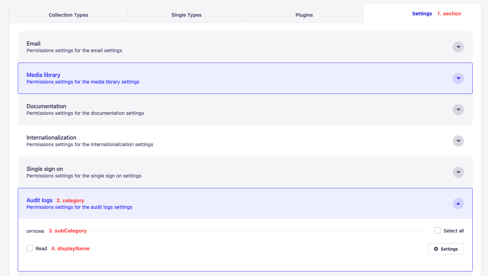

## Overview

The RBAC permission system relies under the hood on the [CASL](https://casl.js.org) library.

A `permission` is the combination of an `action`, a `subject`, some `properties` and some `conditions`.
The logic is that: a user can perform an `action` on a `subject` and some of its `properties` only if its role has the `permission` and if the `conditions` associated to the permission pass.
The creation and edition of permissions is done through the [edit page](http://localhost:1337/admin/settings/roles/2) of a role by checking or unchecking checkboxes.

Example 1: the action `update` can be applied on the subject `article` and property `title`, this result is the permission to update the title of an article.

Example 2: the condition `isCreator` added to the previous permission will ensure that only the creator of the article can update the title.

Example 3: the action `access the Marketplace page` has no subject to apply on. The permission only contains the action `admin::marketplace.read`.

The permissions are attached to a role. Each role can have different permissions independently. There is no inheritance system.
To check if an action can be performed by a user, frontend and backend simply retrieve the list of the permissions associated with the user's roles and check if it contains the permission associated with the action about to be performed. The backend also runs the associated conditions.

:::tip
If a user has several roles, the user will be allowed to perform an action if at least one of its roles is allowed to perform it.
:::

## Actions

### Action definition

An action contains the following information:

| key                           | description                                                                                                                                                                                                                 | type   | required | Default value | example                    |
| ----------------------------- | --------------------------------------------------------------------------------------------------------------------------------------------------------------------------------------------------------------------------- | ------ | -------- | ------------- | -------------------------- |
| **uid**                       | An id that has to be unique within the plugin.                                                                                                                                                                              | string | required | -             | `'audit-logs.read'`        |
| **pluginName**                | Name of the plugin registering the action.                                                                                                                                                                                  | string | -        | `'api'`       | `'admin'`                  |
| **section**                   | Name of the section among `contentTypes`, `plugins`, `settings` and `internal`. It will define in which permission tab the action will appear. <br/> `internal` is not displayed in any tab but used for internal purposes. | string | required | -             | `'settings'`               |
| **category**                  | Name of the category. It will define in which category the action will appear. _Only for the plugins and settings section_.                                                                                                 | string | -        | -             | `'audit logs'`             |
| **subCategory**               | Name of the subcategory. It will define in which subcategory or the category the action will appear. _Only for the plugins and settings section_.                                                                           | string | -        | -             | `'options'`                |
| **displayName**               | Human name of the action.                                                                                                                                                                                                   | string | required | -             | `'Read'`                   |
| **subjects**                  | List of subjects the action can be applied to. _Only for the contentTypes section_.                                                                                                                                         | array  | -        | -             | `['api::article.article']` |
| **options**                   | Option object                                                                                                                                                                                                               | object | -        | `{}`          | `{}`                       |
| **options.applyToProperties** | List of properties the action can be applied to. _Only for the contentTypes section_.                                                                                                                                       | -      | -        | `[]`          | `['fields', 'locale']`     |



_above: Screenshot of the RBAC edit page showing the where are located the section, category, subcategory and display name_

:::note
`uid` and `pluginName` are used to create a global unique id.

Examples: `admin::audit-logs.read`, `plugin::content-manager.explorer.create`
:::

### Register an action

An action can be registered in the backend during the `register` or `bootstrap` phase of the app or of a plugin. Once the admin cleaned the stored permissions, or once Strapi is loaded, `register` throws.

Once every `bootstrap` has run, the admin resets the super admin permissions and deletes the stored permissions that have an unregistered action, a subject the action does not list, only properties that no longer exist (role permissions only), or neither a role nor an admin token. It logs one warning with the count, actions, subjects and owners of the deleted permissions. It does this in the first `strapi::app.afterBootstrap` handler, so actions registered in the app `bootstrap` keep their permissions across restarts. The handler locks the action provider before the cleanup, so an action registered in a later `strapi::app.afterBootstrap` handler throws instead of losing its permissions.

Example:

```ts
// bootstrap.ts
module.exports = async () => {
  const actions = [
    {
      uid: 'provider-login.read',
      displayName: 'Read',
      pluginName: 'admin',
      section: 'settings',
      category: 'single sign on',
      subCategory: 'options',
    },
  ];
  await strapi.service('admin::permission').actionProvider.registerMany(actions);
};
```

When the cleanup deletes permissions, it logs one warning with the count, the actions, the subjects, and the roles and admin tokens that lost them. Permissions with neither a role nor an admin token are only counted. No warning is logged when nothing is deleted.

Content API token permissions are cleaned separately during the admin `bootstrap`. The ones whose action is no longer registered are deleted, with one warning that lists the count, the actions, the API tokens, and how many had no API token. The full read stays unpopulated; only the rows being deleted are read with their token, in batches.

### Parametrize actions

Actions can be parametrized with the `actionParameters` property. This property is an object that can contain any key/value pair.

An example of the feature:

- The action `review-workflows.stage.transition` can be parametrized with the `from` and `to` parameters, which are the ids of the stages a user can transition from and to.

At the moment only Review Workflows use this feature internally.

## Conditions

### Condition definition

A condition contains the following information:

| key             | description                                                                                                                                                                                        | type   | required | default value | example        |
| --------------- | -------------------------------------------------------------------------------------------------------------------------------------------------------------------------------------------------- | ------ | -------- | ------------- | -------------- |
| **displayName** | The condition name as shown in the admin panel                                                                                                                                                     | string | required | -             | `'Is creator'` |
| **name**        | A name that has to be unique within the plugin                                                                                                                                                     | string | required | -             | `'is-creator'` |
| **plugin**      | Name of the plugin that register the condition                                                                                                                                                     | string | -        | `'api'`       | `'admin'`      |
| **category**    | Name of the category. Conditions can be grouped into categories available in the admin panel                                                                                                       | string | -        | `'Default'`   | `'admin'`      |
| **handler**     | A function used to verify the condition (see [docs.strapi.io](https://docs.strapi.io/developer-docs/latest/setup-deployment-guides/configurations/optional/rbac.html#using-the-condition-handler)) | string | required | -             | `'admin'`      |

:::note
Currently the user can choose to apply a condition on any action. There is no way to define a list of actions on which the condition can be applied to. This is why it is possible to set the condition `isCreator` on a the action `plugin::content-manager.explorer.create` even if it doesn't make sense.
:::
:::note
`name` and `plugin` are used to create a global unique id.

Examples: `admin::is-creator`
:::

### Registering a condition

A condition can be registered in the backend during the `bootstrap` phase of the app.

Example:

```ts
// bootstrap.ts
module.exports = async () => {
  const conditions = [
    {
      displayName: 'Is creator',
      name: 'is-creator',
      plugin: 'admin',
      handler: (user) => ({ 'createdBy.id': user.id }),
    },
  ];
  await strapi.service('admin::permission').conditionProvider.registerMany(conditions);
};
```

More information on how the handler works [here](https://docs.strapi.io/developer-docs/latest/setup-deployment-guides/configurations/optional/rbac.html#using-the-condition-handler).

## Permissions

### Permission definition

The permissions are modified in the admin panel (on the [edit page](http://localhost:1337/admin/settings/roles/2) of a role) and stored in the database with the following information:

| key                  | description                                                                                                                | type   | required | example                                                       |
| -------------------- | -------------------------------------------------------------------------------------------------------------------------- | ------ | -------- | ------------------------------------------------------------- |
| **action**           | Id of the action that will be permitted.                                                                                   | string | required | `'plugin::content-manager.explorer.update'`                   |
| **actionParameters** | Object to parametrize actions.                                                                                             | string | -        | `{}`                                                          |
| **subject**          | Id of the subject on which the action will be permitted.                                                                   | string | -        | `'api::article.article'`                                      |
| **properties**       | List of the properties of the subject on which the action will be permitted                                                | object | -        | `{ fields: ['title', 'description'], locales: ['en', 'fr'] }` |
| **conditions**       | List of the conditions that will be ran against an entry to determine whether the action on this entry is permitted or not | array  | -        | `['admin::is-creator']`                                       |

A permission contains all needed information for the backend and the frontend to prevent users to perform non-permitted action.

### Permission ceiling

A user can only hand on permissions they hold themselves. The rules live in `server/src/domain/permission/ceiling.ts`.

The engine registers each stored permission as its own rule (`title@en` plus `body@fr` does not give `title@fr`), and the ceiling does the same. A requested permission is split into atoms (one per field, locale and condition combination). It is within the ceiling when each atom is covered by a single held permission with the same `action` and `subject`. Different atoms can be covered by different held permissions. A held permission covers a value if it does not restrict that property or lists the value (`seo` covers `seo.title`), and covers a condition if it is unconditional or lists it. Omitting a restricted property, sending `null` or dropping conditions is rejected.

Held permissions are read as the engine enforces them:

- `fields: []` grants nothing. On a localized subject, a missing `locales` means `locales: []`, even for a super admin's token.
- A permission with action parameters does not hold the plain action, nor does one whose conditions are all unknown. It is registered as `<action>?<parameters>`, so only held permissions with the same action, subject and parameters cover it (`isParameterizedPermissionWithinCeiling`), using the same atom rule.
- Unions on one dimension are fine (`title` and `body` held separately allow `[title, body]`); mixing dimensions is not.

Where it applies:

- **Roles**: `PUT /admin/roles/:id/permissions` returns 403 with the offending permissions in `error.details.permissions`. Super admins are exempt. An admin-token request is checked against the token's permissions and, unless the owner is a super admin, the owner's too (`findRequesterCeilings` in `server/src/services/permission/ceiling-requester.ts`). Permissions the role already carries are not checked, whatever their array order, and neither is a narrowing of one of the role's rows (every atom covered by one existing row, so fewer fields, locales or conditions pass). Recombining two rows, or dropping a row's last condition, is checked. Parameterized requests are never a narrowing. Creating or duplicating a role uses the same endpoint, so the duplicate page first drops source permissions outside the user's ceiling.
- **Admin tokens**: `enforceAdminPermissionsCeiling` in `server/src/services/api-token.ts` rejects (400) permissions the owner does not cover and takes conditions from the owner, not the request. Super-admin owners are unlimited. An admin-token request is limited by the same two ceilings as a role update, and can only read the key of, or regenerate, its own token. Token permissions are re-clamped at startup and whenever the owner's roles change (`reconcileTokenPermissionsToUserCeiling`): uncovered permissions are deleted and conditions follow the owner, with a log warning each time. Parameterized token permissions are reconciled only against the owner's permissions with the same action, subject and parameters (`reconcileParameterizedTokenPermissions`), so they are deleted once the owner loses that exact grant.
- **Role editor**: `admin/src/pages/Settings/pages/Roles/utils/createPermissionChecker.ts` mirrors the rule and disables values and conditions that cannot be added to what is already ticked. A value is tickable only if the resulting row stays within the editor's permissions, or (edit page only) within what the role already stores. A bulk tick picks one held permission and never mixes fields held under different conditions. A component checkbox is enabled when any field under it can be granted, since roles store a component's fields, not its path.
