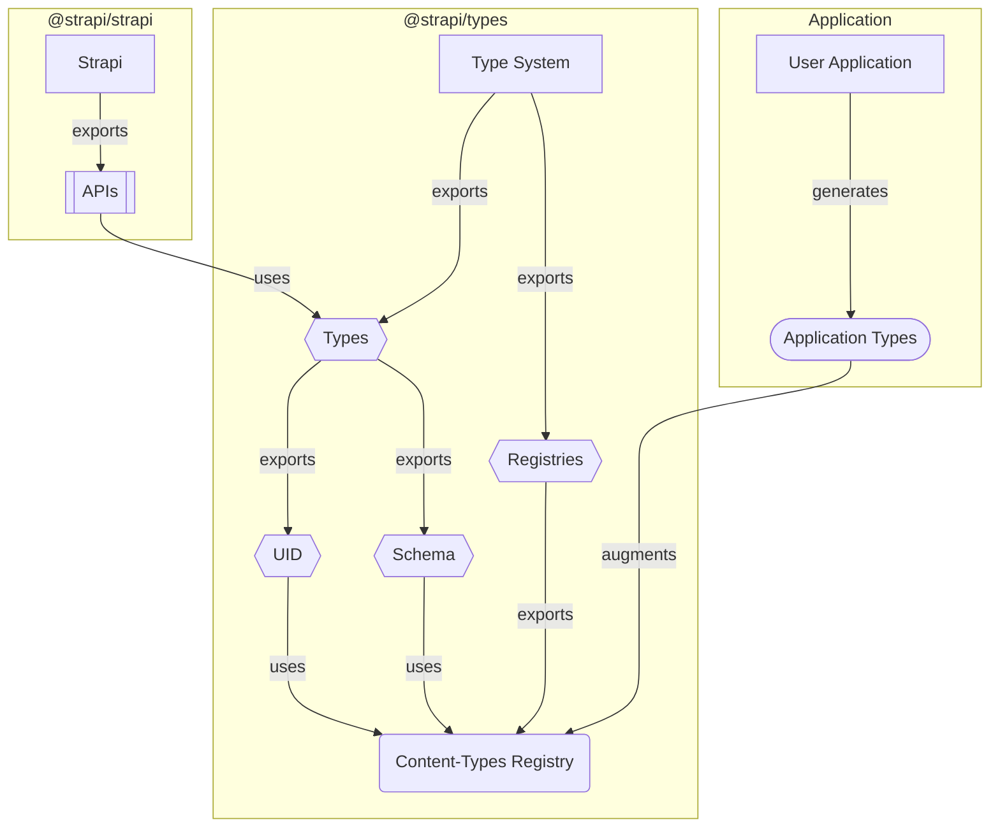

import Tabs from '@theme/Tabs';
import TabItem from '@theme/TabItem';

### Context

#### Why?

The Strapi Type System is designed to provide developers with a fully customizable experience.

It's engineered to adapt and modify its type definitions automatically according to the context of each application and associated resources.

This adaptability extends to various components such as schemas, services, controllers, and more.

:::note
See the [type system principles](../philosophy#key-principles) page for more information about the mission.
:::

#### How?

To meet this requirement, the Type System employs "public registries".

In simple terms, public registries are basic indexed interface definitions that are made publicly available by the types package.

```typescript
export interface MyRegistry {
  [key: string]: GenericResourceDefinition;
}
```

Every resource comes with its own registry that has a set of rules acting as the default state (the index).

Because every registry can be augmented (publicly exported), developers have the freedom to inject their own definitions.

Doing so allows Strapi APIs to respond in a way that aligns with the developers' custom definitions.

:::info[Did you know?]
The `Schema` and `UID` namespaces rely solely on public registries to infer their type definitions. In strict mode, they read the global schema registries instead (see [Strict schema registries](#strict-schema-registries)).

This is why it's heavily encouraged to use them over their low level counter-parts.
:::

### How it works

#### Architecture



#### Usage

##### 1. Registry Definition

Creating a new registry is as simple as exporting an indexed interface from the right namespace.

Let's declare the content-type schema registry.

It should accept:

- Content-type UIDs as keys
- Content-type schemas as values

```ts title="@strapi/types/public/registries.ts"
import type { Internal, Struct } from '@strapi/types';

export interface ContentTypeSchemas {
  [key: Internal.UID.ContentType]: Struct.ContentTypeSchema;
}
```

:::note
We use low level types to define our index (`Internal`/`Struct`) to keep it as generic as possible.
:::

##### 2. Dynamic Type Definitions

###### UID.ContentType

To define `UID.ContentType`, we extract every key (`Internal.Registry.Keys`) from the public content-type registry (`Public.ContentTypeSchemas`) that matches with the base definition of a content-type UID (`Internal.UID.ContentType`).

```ts title="@strapi/types/uid.ts"
import type { Internal, Public } from '@strapi/types';

export type ContentType = Internal.Registry.Keys<
  Public.ContentTypeSchemas,
  Internal.UID.ContentType
>;
```

:::note
Only selecting keys that extend `Internal.UID.ContentType` ensures we don't end up with manually added malformed keys, and tells the type-checker we're confident about what's in our union type.
:::

###### Schema.ContentType

To declare `Schema.ContentType`, we simply query the content-type schema registry (`Public.ContentTypeSchemas`) with the provided content-type UID (`TUID`).

:::note
Since `UID.ContentType` (`TUID`) is [dynamically built based on actual keys](#uidcontenttype), we know for sure that there will be a valid corresponding schema in the registry.
:::

```ts title="@strapi/types/schema.ts"
import type { UID, Public } from '@strapi/types';

export type ContentType<TUID extends UID.ContentType> = Public.ContentTypeSchemas[TUID];
```

##### 3. API Design

To create types for a dynamic API (_aka one that reacts to its context_), simply use dynamic type definitions such as `UID`, `Data` or `Schema`.

```ts title="@strapi/core/document-service.ts"
import type { Data, UID } from '@strapi/types';

export type findOne<TUID extends UID.ContentType>(uid: TUID): Data.ContentType<TUID>;
```

:::caution
Remember to use dynamic type definitions (`UID`, `Data`, `Schema`) and not static ones (`Internal`, `Struct`).
:::

:::info[Reminder]
Registries are **indexed**, which means that:

- **When augmented** (_e.g. in users' applications_), they'll return **strongly typed values** that correspond to the defined types.
- **When empty** (_e.g. in Strapi codebase_), they'll return **generic low level types** based on their index definition.

<Tabs>
  <TabItem value="augmented" label="Augmented">
    ```ts
    import type { UID } from '@strapi/types';

    const uid: UID.ContentType;
    // ^ 'api::article.article' | 'admin::user'
    ```

  </TabItem>
  <TabItem value="empty" label="Empty">
    ```ts
    import type { UID } from '@strapi/types';

    const uid: UID.ContentType;
    // ^ `admin::${string}` | `api::${string}.${string}` | `plugin::${string}.${string}` | `strapi::${string}`
    ```

  </TabItem>
</Tabs>
:::

##### 4. Type Augmentation

###### Manual Augmentation

It's possible to manually augment the public registries to create tailor-made experiences.

```ts title="my-app/index.d.ts"
import type { Struct } from '@strapi/strapi';

interface ApiArticleArticle extends Struct.ContentTypeSchema {
  // ...
}

declare module '@strapi/strapi' {
  export module Public {
    export interface ContentTypeSchemas {
      'api::article.article': ApiArticleArticle;
    }
  }
}
```

This will force every type that depends on the `Public.ContentTypeSchemas` registry to recognize `'api::article.article'` as the only valid UID and `ApiArticleArticle` the only valid schema.

:::note
In the context of a Strapi application, developers are strongly encouraged to use types exported by `@strapi/strapi` and not `@strapi/types`.

This is to allow having both an internal (`@strapi/types`) and a public (`@strapi/strapi`) types API.
:::

###### Automated Augmentation

To ease the registries augmentation, Strapi offers an automated way of generating types and extending the registries.

The process will generate type definitions based on the user application state (`schemas`), then augment the registry using the created types.

<Tabs>
  <TabItem value="manual" label="Manual Run">
    Generate the types once.

```shell title="my-app/"
yarn strapi ts:generate-types
```

  </TabItem>
  <TabItem value="dev" label="During Development">
    Start the application in dev mode, and generate types on every server restart.

    Useful when working with the content-type builder.

```shell title="my-app/"
yarn develop
```

  </TabItem>
</Tabs>

The generated types will automatically augment the corresponding registries.

```ts title="my-app/types/generated/contentTypes.d.ts"
import type { Struct } from '@strapi/strapi';

interface ApiArticleArticle extends Struct.ContentTypeSchema {
  // ...
}

interface AdminUser extends Struct.ContentTypeSchema {
  // ...
}

declare module '@strapi/strapi' {
  export module Public {
    export interface ContentTypeSchemas {
      'api::article.article': ApiArticleArticle;
      'admin::user': AdminUser;
    }
  }
}
```

###### Strict service contracts (`typescript.strictTypes`)

With `strictTypes: true` in `config/typescript.ts` (typed on `Core.Config.TypeScript`, next to `autogenerate`), the same commands generate six more files, so that service, controller, policy and middleware lookups are checked against registered contracts. Turning it off removes them, so the output equals the one without the flag:

- `types/generated/strict.d.ts` holds `import type {} from '@strapi/strapi/strict-types'`. It enables strict mode for the whole program and loads the contracts of the plugins bundled with `@strapi/strapi`; optional plugins are loaded by `plugins.d.ts`. Going through `@strapi/strapi` keeps the application free of direct dependencies on the plugins, which it cannot resolve under a strict package manager layout such as pnpm's.
- `types/generated/plugins.d.ts` imports the server declarations of the enabled optional plugins, such as `import type {} from '@strapi/plugin-sentry/strapi-server'`. Plugins that `@strapi/strapi/strict-types` already loads are left out, so the file holds no package manager store path.
- `types/generated/services.ts` registers every `api::*` service of the application in the global `Strapi.Registries.AppServices`, typed from its source file.
- `types/generated/controllers.ts` does the same for `api::*` controllers, in the global `Strapi.Registries.AppControllers`.
- `types/generated/policies.ts` registers the config of every `global::*` and `api::*` policy in the global `Strapi.Registries.AppPolicies`.
- `types/generated/middlewares.ts` does the same for `global::*` and `api::*` middlewares, in the global `Strapi.Registries.AppMiddlewares`.

These four files are sources, not declaration files, so `skipLibCheck` does not hide their errors:

- A reference that went stale since the last generation, such as a renamed contract export (TS2694) or a moved or deleted source (TS2307), is reported at the generated line.
- `strapi build` compiles without generating types, so it fails on stale committed generated files until `strapi develop` or `strapi ts:generate-types` regenerates them.
- Each file starts with `/* eslint-disable */` and `/* oxlint-disable */`, and declares a helper (`ServiceInstance`, `ServiceContractOf`, ...) only when an entry reads it, so `noUnusedLocals` stays clean.
- Writing one of them removes the `.d.ts` file an earlier version generated under the same name.
- They import each TypeScript source by the path of its compiled file, such as `import('../../src/api/article/services/article.js')`. An ECMAScript module application (`"type": "module"`) resolved with `NodeNext` requires that extension, and the other module resolutions map it back to the `.ts` source.

```ts title="my-app/types/generated/services.ts"
/* eslint-disable */
/* oxlint-disable */
export {};

type ServiceInstance<TModule> = TModule extends { default: infer TExport }
  ? TExport extends (...args: any[]) => infer TInstance
    ? TInstance
    : TExport
  : unknown;

declare global {
  namespace Strapi {
    namespace Registries {
      interface AppServices {
        'api::article.article': ServiceInstance<
          typeof import('../../src/api/article/services/article.js')
        >;
      }
      interface InferredServices {
        'api::article.article': true;
      }
    }
  }
}
```

The generator mirrors the API loader: it walks `src/api/<api>/services/*.{ts,js}`, derives the uid with the same kebab-case normalization, and only emits uids the running application registered. A factory (`createCoreService(...)` or `({ strapi }) => ({ ... })`) registers its return type, a plain object registers itself, and a module without a default export resolves to `unknown`, like any unregistered service in strict mode. A module that assigns its value with `export =` registers that value: the generator wraps the module type as `{ default: typeof import('<source>') }`, the value `importDefault` returns for it. A CommonJS-style `.ts` source (`module.exports = …`, or no `import` or `export` at all) registers `unknown` without an import: TypeScript does not type `module.exports` in a `.ts` file, and importing a file without ECMAScript module syntax fails with TS2306, which would stop the `strapi develop` compilation. A module or a default export typed `any` registers `unknown` too, rather than turning every lookup of the uid into `any`. The registries are global interfaces, so the generated entries merge with the application's own `AppServices` declarations; declaring the same uid twice with different types is a TS2717 conflict.

A service module can also export its contract as a type named `ServiceContract`. The generator then registers that type instead of the inferred one, and adds a `ServiceContractOf` helper to the file:

```ts title="my-app/src/api/article/services/article.ts"
import { factories, type Core } from '@strapi/strapi';

export type ServiceContract = Core.CoreAPI.Service.ContentType<'api::article.article'> & {
  findPublishedTitles(): Promise<string[]>;
};

export default factories.createCoreService('api::article.article', ({ strapi }) => ({
  async findPublishedTitles() {
    const articles = await strapi
      .documents('api::article.article')
      .findMany({ status: 'published' });
    return articles.map((article) => article.title);
  },
})) satisfies Core.ServiceFactory<'api::article.article'>;
```

```ts title="my-app/types/generated/services.ts"
type ServiceContractOf<TContract> = 0 extends 1 & TContract ? unknown : TContract;

declare global {
  namespace Strapi {
    namespace Registries {
      interface AppServices {
        'api::article.article': ServiceContractOf<
          import('../../src/api/article/services/article.js').ServiceContract
        >;
        'api::legacy.legacy': ServiceInstance<
          typeof import('../../src/api/legacy/services/legacy.js')
        >;
      }
      interface InferredServices {
        'api::legacy.legacy': true;
      }
    }
  }
}
```

- The contract does not depend on the default export, so `satisfies Core.ServiceFactory<'api::article.article'>` checks the factory against it: a member with the wrong type, or a missing member, is reported at the factory. A member the factory returns outside the contract is not reported, and `strapi.service(uid)` callers do not see it.
- A module without a `ServiceContract` export keeps the inferred type, and the generator lists its uid in `InferredServices`. `Core.ServiceFactory` rejects that uid with TS2344 (`Type '"api::legacy.legacy"' does not satisfy the constraint …`): the inferred type is read from the factory, so checking the factory against it would be circular. The marker only has keys, so the rejection does not depend on the order TypeScript checks files in, and lookups of the uid keep the inferred type. Add a `ServiceContract` export to check the factory.
- The generator reads each source on its own, without a type checker: it finds `export type ServiceContract`, `export interface ServiceContract` and export specifiers such as `export type { ArticleContract as ServiceContract } from '../contract'`. It does not follow `export *`, and it skips JS sources.
- A generic contract needs a default for each type parameter. Otherwise the generator ignores it with a warning and registers the inferred type.
- An export specifier without `from` follows the declaration it names in the module: `type ServiceContract<T> = …; export { ServiceContract }` is ignored with a warning, as the `export type` form is. A specifier of a variable or a function, such as `const ServiceContract = …; export { ServiceContract }`, names a value rather than a type: the generator ignores it with a warning too. A class or an enum is a type, and a generic class needs the same defaults. A specifier of an imported binding counts, without a check.
- A contract typed `any` registers `unknown`. A reference that no longer resolves, because the export was renamed after the generation, behaves as `any` until the next generation drops it. The generated file reports a TS2694 meanwhile, with `skipLibCheck` too.
- The generator does not follow a re-export from another module (`export { ServiceContract } from '../contract'`) or an imported binding. When it names a value, or a generic without defaults, the generated file reports TS2694 or TS2314 at each generation, which stops the `strapi develop` compilation (`noEmitOnError`).
- Keep a shared contract file out of `services/` and `controllers/`: the API loader registers every file there, so `services/contract.ts` would register an `api::article.contract` service.

`controllers.ts` follows the same rules for `src/api/<api>/controllers/*.{ts,js}`, with its own `ControllerInstance` helper so that each file stands alone. A `createCoreController(...)` export registers the controller the factory returns: the content-type actions (`find`, `findOne`, ...) and the custom actions. `strapi.controller('api::article.article')` and `strapi.api('article').controller('article')` then resolve to that type, and an unregistered uid resolves to `unknown`.

A controller module can export its contract as `ControllerContract`, which the generator registers through a `ControllerContractOf` helper, with the same rules as `ServiceContract`: a controller without it is listed in `InferredControllers`, which `Core.ControllerFactory` rejects. `satisfies Core.ControllerFactory<uid>` then checks the factory against it, including a `createCoreController(...)` factory, whose missing custom actions are reported:

```ts title="my-app/src/api/article/controllers/article.ts"
import { factories, type Core } from '@strapi/strapi';

export type ControllerContract = Core.CoreAPI.Controller.ContentType<'api::article.article'> & {
  titles: Core.ControllerHandler<string[]>;
};

export default factories.createCoreController('api::article.article', ({ strapi }) => ({
  async titles() {
    return strapi.service('api::article.article').findPublishedTitles();
  },
})) satisfies Core.ControllerFactory<'api::article.article'>;
```

With strict types disabled, `Core.ControllerFactory` accepts a factory that returns any object, as develop has no controller factory type.

`policies.ts` walks `src/policies/*.{ts,js}` (`global::<name>`, names kept as is, like the global policies loader) and `src/api/<api>/policies/*.{ts,js}` (`api::<api>.<name>`, kebab-cased), with its own `PolicyConfig` helper. The registered value is the config the policy accepts: the second parameter of its handler, for a bare handler and for `{ handler, validator }`. A handler without that parameter registers `undefined`, so its name alone is a valid reference; an untyped (`any`) config, a CommonJS-style `.ts` policy and a JS policy, whose import does not resolve without `allowJs`, register `unknown`. An `export =` policy registers the config of the handler it assigns, as for services. A `.ts` policy without a default export is left out, and the generator logs a warning that names the file: runtime registers `undefined` for it and a route that references it fails at startup (`Policy <name> not found.`), so a strict reference to it is rejected like an unregistered name. Typed route configs (`Core.RouterInputFor`, `Core.RouteConfigFor`) then accept these policies and check their `config`, next to the policies bundled packages register in `PackagePolicies`, and `strapi.policy('global::is-owner')` resolves to a policy that receives that config.

Middlewares follow the same model in `Strapi.Registries.PackageMiddlewares` and `AppMiddlewares`: the registered value is the config the factory accepts as its first parameter, `undefined` when it takes none. Bundled packages register theirs (`strapi::*`, `admin::*`, `plugin::email.rateLimit`, ...), so `strapi.middleware('strapi::cors')` resolves to a factory that receives the CORS config. Typed route configs accept registered names (alone only when the config is optional), `{ name, config }` checked against the registered config, inline handlers and `{ resolve, config }` entries, and reject unregistered names. An entry takes `name` or `resolve`, not both: runtime resolves `name` and ignores `resolve`. Editors list the config keys inside `{ name: 'admin::rateLimit', config: { } }`, but no name inside `{ name: '' }`: the inline handler member has `Function.name: string`, which matches any string being typed, so the object literal is typed as the handler. Bare names are listed.

`middlewares.ts` walks `src/middlewares/*.{ts,js}` (`global::<name>`, names kept as is, like the global middlewares loader) and `src/api/<api>/middlewares/*.{ts,js}` (`api::<api>.<name>`, kebab-cased), with its own `MiddlewareConfig` helper, and only emits uids the running application registered. The registered value is the first parameter of the exported factory: a factory without parameters registers `undefined` and an optional parameter keeps `undefined`, so the name alone is a valid reference; an untyped (`any`) config, a CommonJS-style `.ts` middleware and a JS middleware register `unknown`, and an `export =` middleware registers the config of the factory it assigns, as for policies. A handler whose context is typed `any` registers `unknown` too: it cannot be told apart from a factory with an untyped config, while exporting the factory typed as `Core.MiddlewareFactory<TConfig>` registers `TConfig`. A `.ts` middleware without a default export is left out with a warning, as for policies (`Middleware <uid> not found.` at startup). Typed routes then accept `{ name: 'global::rate-limit', config: { max: 10 } }` checked against that config, and `strapi.middleware('global::rate-limit')` resolves to a factory that receives it.

###### Strict schema registries

With `strictTypes: true`, `contentTypes.d.ts` and `components.d.ts` keep their names and their schema interfaces, but register the schemas in the global `Strapi.Registries.ContentTypeSchemas` and `Strapi.Registries.ComponentSchemas` instead of `Public`:

```ts title="my-app/types/generated/contentTypes.d.ts"
import type { Struct } from '@strapi/strapi';

export interface ApiArticleArticle extends Struct.CollectionTypeSchema {
  // ...
}

declare global {
  namespace Strapi {
    namespace Registries {
      interface ContentTypeSchemas {
        'api::article.article': ApiArticleArticle;
      }
    }
  }
}
```

A global augmentation reaches the one declaration every package reads, whatever module the application resolves and in whatever order declaration files load. Augmenting `Public` through `@strapi/strapi` and through `@strapi/types` creates two copies, and the load order decides which one wins.

Each schema registry is one interface, without a `Package*` and `App*` pair: type generation is the only producer, and applications do not override schemas.

|                 | `UID.ContentType`, `Schema.ContentType`, … read                                                                   | No generated schema                               |
| --------------- | ----------------------------------------------------------------------------------------------------------------- | ------------------------------------------------- |
| Strict mode off | `Public.ContentTypeSchemas`, `Public.ComponentSchemas`. Global entries are ignored.                               | Generic UIDs and schemas                          |
| Strict mode on  | `Strapi.Registries.ContentTypeSchemas`, `Strapi.Registries.ComponentSchemas`. `Public` augmentations are ignored. | Generic UIDs and schemas, as with strict mode off |

Toggling the flag rewrites both files in the other form on the next generation. A hand-written `Public` schema augmentation has no effect in strict mode: move it to the global registry.

Unset or `false` keeps the previous behavior — content-type, component and plugin declarations are still generated — and removes `strict.d.ts`, `services.ts`, `controllers.ts`, `policies.ts` and `middlewares.ts` (and an older `.d.ts` of the last four) if a previous run generated them, so the program leaves strict mode when the flag is turned off. Any other value is rejected. TypeScript templates of `create-strapi-app` ship `config/typescript.ts` with `strictTypes: true`.

:::caution
Strict mode is closed: a lookup without a registered contract resolves to `unknown`, including services of plugins that publish no contracts. Pass an explicit type argument (`strapi.plugin('x').service<MyService>('y')`) for those.

A `createCoreService` service whose method returns the result of a lookup of the service itself is circular, because `TService` is inferred from the object literal that contains the lookup. The compiler reports `TS7022` on the default export and the whole service becomes `any`; annotate that method's return type to break the cycle.
:::

---

When coupling everything together, the end result is a TypeScript developer experience automatically adjusted to the current context.

{/* prettier-ignore-start */}

<Tabs>
<TabItem value="app" label="User Application">
```ts title="my-app/src/index.ts"
export default () => ({
  bootstrap() {
    strapi.findOne('ap');
    //                ^ TypeScript will autocomplete with "api::article.article"

    strapi.findOne('ad');
    //                ^ TypeScript will autocomplete with "admin::user"

    strapi.findOne('api::blog.blog');
    //                ^ Error, TypeScript will complain
  }
})
```
</TabItem>
<TabItem value="strapi" label="Strapi Codebase">
```ts title="@strapi/strapi/document-service.ts"
import type { UID } from '@strapi/types';

export const findOne<TUID extends UID.ContentType>(uid: TUID) {
  // ...
}

findOne('admin::foo');
//           ^ Valid, matches 'admin::${string}'

findOne('plugin::bar.bar');
//           ^ Valid, matches 'plugin::${string}.${string}'

findOne('baz');
//           ^ Error, does not correspond to any content-type UID format
```
</TabItem>
</Tabs>

{/* prettier-ignore-end */}
