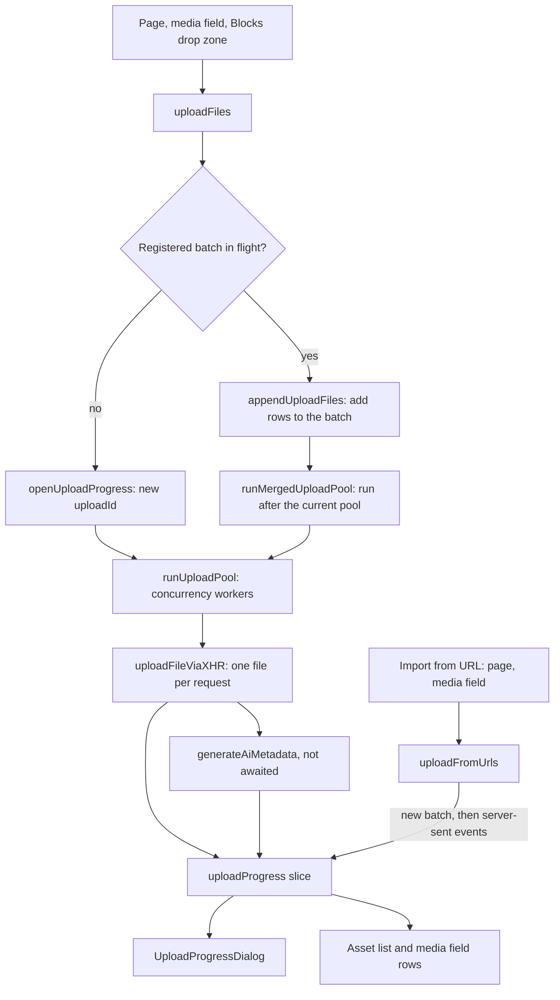

# Uploads

The Media Library admin sends new files with two RTK Query mutations in [`services/api.ts`](https://github.com/strapi/strapi/blob/develop/packages/core/upload/admin/src/services/api.ts): `uploadFiles` for files from the computer, and `uploadFromUrls` for URL imports. Both write their progress to the `uploadProgress` Redux slice, and the upload progress dialog renders it. Replacing or cropping an asset uses `replaceAsset` instead, and a cropped copy uses `uploadFileSilently`, see [Asset details drawer](./02-asset-details-drawer.md). The API slice and its cache tags are in [Data fetching](./07-data-fetching.md).

## Entry points

| Entry point                                                                                      | Code                                                                                                                                                                                | Mutation                        | Target folder        |
| ------------------------------------------------------------------------------------------------ | ----------------------------------------------------------------------------------------------------------------------------------------------------------------------------------- | ------------------------------- | -------------------- |
| "File upload" in the **New** menu and the background context menu, and files dropped on the page | `pages/Assets/AssetsPage.tsx`, [`pages/Assets/components/DropZone/`](https://github.com/strapi/strapi/tree/develop/packages/core/upload/admin/src/pages/Assets/components/DropZone) | `uploadFiles`                   | The folder on screen |
| "File upload from URL" in the same menus                                                         | `pages/Assets/components/ImportFromUrlDialog.tsx`, `handleUrlUpload` in `AssetsPage.tsx`                                                                                            | `uploadFromUrls`                | The folder on screen |
| Files dropped on the Blocks editor                                                               | [`components/EditorFileDropZone/`](https://github.com/strapi/strapi/tree/develop/packages/core/upload/admin/src/components/EditorFileDropZone)                                      | `uploadFiles`                   | Root                 |
| The `media` field                                                                                | [`components/MediaLibraryInput/`](https://github.com/strapi/strapi/tree/develop/packages/core/upload/admin/src/components/MediaLibraryInput)                                        | `uploadFiles`, `uploadFromUrls` | Root                 |

Rules that every entry point follows:

- It reads `concurrentUploadRequests` from `useGetUploadSettingsQuery`, with 1 when the settings are missing, and the AI flag from `useAIMetadataEnabled()`. It passes both to `uploadFiles`, and only the AI flag to `uploadFromUrls`. A new entry point must do the same and must go through `uploadFiles`, so its files share the pool and show in the dialog.
- For `uploadFiles`, the folder is set per file, in the `fileInfo` JSON that goes with the `files` entries of the `FormData`. `uploadFromUrls` sends one `folderId` for the whole import, and the server builds the `fileInfo` itself.
- A drop zone activates only when `dataTransfer.types` contains `Files` on `dragenter`. The page drop zone still calls `preventDefault` on every `dragover` and `drop`. Moving assets does not reach it because it uses pointer events, not an HTML5 drag. The page drop zone is disabled without `plugin::upload.assets.create`. The Blocks drop zone shows a "no permission" frame and sets `dropEffect` to `none` while the permissions load or when the user cannot create assets.
- `ImportFromUrlDialog` validates the input with `validateUrls` in `utils/files.ts`: at most 20 URLs, each one parsed with `new URL`. The dialog closes before the upload starts, and the progress shows in the upload progress dialog only.
- `index.ts` registers the Blocks drop zone as the `media-library-file-drop-zone` component, only when the legacy Media Library is off. `BlocksContent.tsx` in the Content Manager renders it when it is registered and the field is not disabled, passes `allowedTypes={['images']}`, and inserts each uploaded image through `onDropFiles`.
- The `media` field tags its rows with `owner`, set to the field name, and receives each file through `onFileUploaded`. Its own handling is in [Media field and picker](./05-media-field-and-picker.md).

## One request per file

`uploadFiles` takes the combined `FormData`, splits it into one entry per file, and posts each file alone to `POST /upload/files` with [`services/uploadFileViaXHR.ts`](https://github.com/strapi/strapi/blob/develop/packages/core/upload/admin/src/services/uploadFileViaXHR.ts). It uses `XMLHttpRequest` because `fetch` does not report upload progress. One request per file also gives each file its own error, cancel and retry.

- The token comes from `admin_app.token` in the store. On a 401, `uploadFileViaXHR` calls `attemptTokenRefresh` once and sends the request again.
- An abort throws `UploadAbortedError`, except during the 401 retry: an abort there rethrows the original 401 as an `UploadFileError`, and the row ends as `error`, not `cancelled`. Any other failure throws `UploadFileError`, which keeps the status, the `name` of the Strapi error envelope as `errorName`, its `details`, and `isServerMessage`. That flag is false for the English fallback messages that the module writes itself.
- `xhr.upload.onprogress` goes through `createRafBatcher` in `utils/createRafBatcher.ts`, so each file dispatches at most one `setFileProgress` per animation frame.
- The response can lack the `folder` relation. `withTargetFolder` then copies the folder from the `fileInfo`, because the asset list needs it to place the new asset.

### The worker pool

`runUploadPool` starts `concurrency` workers on one shared queue. A worker takes the next file as soon as its current file settles, so `concurrency` files are in flight at any time, not in waves. A value below 1 or not finite gives one worker, and the pool never starts more workers than files. A failed file does not stop the others. An abort stops the workers before they start another file.

`concurrency` is `concurrentUploadRequests` from the `plugin::upload` config, which `GET /upload/settings` echoes, 1 by default. It limits the parallel requests of the browser. The server option `concurrentUploadSize` is a different setting.

### Batches and merging

A batch is one `uploadId`. `openUploadProgress` replaces every row and increments `uploadId`. Each per-row action carries the `uploadId` it was sent for, and the reducers ignore those of an older batch, so a late callback cannot write to a row of a newer batch that reuses the same index. `setUploadFailed` is the exception: it carries no `uploadId` and marks every `pending` or `uploading` row of the current batch.

`uploadFiles` merges into the current batch when that batch is in `uploadRegistry` and still has a `pending` or `uploading` row (`isUploadInFlight`):

- `appendUploadFiles` adds rows with indices after the existing ones, and shows and expands the dialog again.
- The new files adopt the `concurrency` and AI flag of the batch, because a new concurrency would raise the limit that the batch applies. Each file keeps its own `fileInfo`, so its folder does not change.
- `runMergedUploadPool` chains the new run behind the current run of the batch, kept in `poolTails`. Two pools side by side would double the files in flight. The new files therefore start when the earlier run ends.
- The merged call resolves with its own files only, not with the whole batch.

A batch whose rows are all `complete`, `error` or `cancelled` is settled, and the next call replaces it. `uploadFromUrls` never registers its batch, so nothing merges with it: it always opens a new batch, and a file upload started during a URL import opens a new batch too. The requests of a replaced batch keep running, and the reducers drop their per-row updates. A replaced URL import that then fails still dispatches `setUploadFailed`, which reaches the new batch.

The state that Redux cannot hold lives in module-level maps in `api.ts`: `uploadRegistry` (the `File` objects, `fileInfo`, `onUploaded` callback and flags of each batch), `abortControllers` (one per batch), `fileAbortControllers` (one per file in flight), `skippedFiles` and `poolTails`. The exported abort functions read them, because the component that cancels an upload is not the one that started it. `getUploadSourceFile` returns the original `File` of a row, for the preview in the `media` field.

### Cancel and retry

The pool never marks an aborted row. Whoever aborts also dispatches the matching reducer, or the row stays `uploading` and the batch never settles.

| Abort                              | Reducer                           | Effect                                                                                                                                                                                            |
| ---------------------------------- | --------------------------------- | ------------------------------------------------------------------------------------------------------------------------------------------------------------------------------------------------- |
| `abortUpload(uploadId)`            | `cancelUpload()`                  | Aborts the batch controller that is registered for the batch, which the file controllers of its pool listen to. Clears the skip markers of the batch, so a later retry does not skip those files. |
| `abortUploadFile(uploadId, index)` | `cancelFile({ uploadId, index })` | Aborts the request of a file in flight. For a queued file, adds a skip marker that the worker consumes when it reaches the file.                                                                  |

- `retryCancelledFiles` uploads every `cancelled` row of the current batch again, with a new batch controller and the flags of the batch. The Retry button of the dialog calls it. It does not retry `error` rows. The dialog shows Retry while any row is cancelled, even while other rows still upload. A retry then runs beside the current pool, and its controller replaces the registered one, so Cancel all no longer reaches the first pool.
- `retryUploadFile({ uploadId, index })` puts one `cancelled` or `error` row back to `pending`, clears its skip marker, and chains the upload behind the current run, like a merge. The `media` field uses it.
- Both read the batch from `uploadRegistry`. The `onUploaded` callback is stored with each entry, so a retried file still reaches the caller that started it. URL batches are not in the registry and cannot be retried.

### Silent uploads

`uploadFileSilently` posts one file through `uploadFileViaXHR`, with no row, no dialog, no cancel, no retry and no AI metadata. `AssetDetails` uses it in `handleCropSaveAsCopy`, when the crop editor saves a cropped copy. On failure, it returns the server message only when `isServerMessage` is true, and an empty string otherwise, so the localized message of the caller wins over the English fallback.

## URL imports

`uploadFromUrls` sends `{ urls, folderId }` as JSON with `fetch` to `POST /upload/actions/upload-from-urls`. The server fetches the files and answers with a stream of server-sent events, which `processSSEStream` reads:

| Event             | Store update                                                                                                                                 |
| ----------------- | -------------------------------------------------------------------------------------------------------------------------------------------- |
| `file:fetching`   | The row goes to `uploading`.                                                                                                                 |
| `file:progress`   | `setFileProgress` with `loadedBytes`, and `totalBytes` as the row size. Ignored when `totalBytes` is `null`, so the row stays indeterminate. |
| `file:uploading`  | The row goes to `uploading` and gets its size.                                                                                               |
| `file:complete`   | The row goes to `complete`, then AI metadata starts.                                                                                         |
| `file:error`      | The row goes to `error`, with `tooLarge` when the details name a size limit.                                                                 |
| `stream:complete` | Becomes the result of the mutation when its `data` is not empty. Otherwise the mutation returns empty `data` and `errors`.                   |

The rows open with size 0, so `reportsByteProgress` is false and the dialog header uses `selectCountBasedProgress` instead of the byte-weighted `selectAggregateProgress`. The server already throttles `file:progress`, so this flow does not batch it. A failed response or a network error dispatches `setUploadFailed`, which marks every `pending` or `uploading` row as `error`. An abort returns an error and leaves the rows to `cancelUpload`. This flow does not refresh the token on a 401.

## The progress store

[`store/uploadProgress.ts`](https://github.com/strapi/strapi/blob/develop/packages/core/upload/admin/src/store/uploadProgress.ts) defines the slice. `index.ts` registers it with `app.addReducers({ uploadProgress: uploadProgressReducer })`, only when the legacy Media Library is off. The readers outside the dialog, `selectCompletedUploads` and `useFieldUploads`, handle a missing slice.

The slice holds the latest batch only: `uploadId`, `totalFiles`, `isVisible`, `isMinimized`, `reportsByteProgress` and one row per file. A row has a `status` (`pending`, `uploading`, `complete`, `error` or `cancelled`), `size` and `uploadedBytes`, and `file` and `completedAt` once the server has created the asset. It can also carry `error`, `tooLarge`, `metadataStatus` and `owner`. The slice also keeps an `errors` list, but no component reads it. Read the row status instead. `metadataStatus` (`generating`, `generated`, `skipped` or `failed`) is separate from `status`, so a metadata failure never turns a successful upload into an error. `undefined` means the row has no metadata phase.

`uploadFiles` invalidates the `Asset` and `Folder` `LIST` tags only when the mutation resolves, at the end of the run. To show each asset as soon as it lands, `useInfiniteAssets` reads `selectCompletedUploads` and passes the completed assets of the folder on screen to `mergeUploadedAssets` in `pages/Assets/utils/mergeUploadedAssets.ts`. Only a list without a search or filters does this, because matching a filter would mean copying the server's filter rules. `mergeUploadedAssets` inserts each asset at its sort position, keeps the server copy when the list already has the id, and skips an asset that sorts after the loaded rows while more pages remain. `useInfiniteAssets` stops adding an asset once the list has data from a request that started after the upload completed, so a later delete or move does not bring it back.

## The upload progress dialog

[`components/UploadProgressDialog.tsx`](https://github.com/strapi/strapi/blob/develop/packages/core/upload/admin/src/components/UploadProgressDialog.tsx) renders the slice in the shared `Drawer` shell, described in [Asset details drawer](./02-asset-details-drawer.md). It has two gates. `index.ts` registers it as the `future-global::upload-progress` component, only when `useLegacyMediaLibrary` is off. [`packages/core/admin/admin/src/App.tsx`](https://github.com/strapi/strapi/blob/develop/packages/core/admin/admin/src/App.tsx) renders every `future-global::` component next to the route `Outlet`, also only when the flag is off. `App` is the element of the root route, so the dialog stays mounted, and keeps reporting, when the user leaves the Media Library page.

- **Cancel all** shows until every row has settled. It calls `abortUpload`, then dispatches `cancelUpload`. **Retry** shows while any row is `cancelled`.
- **Minimize** dispatches `toggleMinimize`, which collapses the file list and keeps the header. A new batch or a merge expands the dialog again.
- **Close** shows only once every row has settled. It dispatches `closeUploadProgress`, which hides the dialog and empties the rows and `errors`. It keeps `uploadId` and does not call `abortUpload`. Escape closes the dialog the same way, even while files upload, because `Drawer.Root` turns any Radix close into `onClose` and the dialog does not veto Escape. The requests then keep running, and their updates find no row. The `media` field hides the rows it started as `cancelled`, but the files still upload and `onFileUploaded` still attaches them to the field.

The header shows a failed state only when every row failed. A settled batch with at least one uploaded file and no cancelled row shows success, with the count of failed files. A row bar is determinate only while `uploadedBytes` is between 0 and `size`. At 100% the row is still `uploading`, because the server has not answered yet, so the bar goes back to indeterminate. A visually hidden `aria-live="polite"` region announces each failed row with its cause only.

## AI metadata after upload

[`hooks/useAIMetadataEnabled.ts`](https://github.com/strapi/strapi/blob/develop/packages/core/upload/admin/src/hooks/useAIMetadataEnabled.ts) decides whether a batch generates metadata. With no argument, it is true when `useAIMetadataAvailability` reports a registered provider (`aiMetadataAvailable` in the settings response) and the stored `aiMetadata` setting is on. Without `plugin::upload.read`, the settings query is skipped and the hook returns false. `AssetActions.tsx` and `AssetDetailsDrawer.tsx` pass `{ mime }`, which also requires a supported image type. Upload callers pass the result as `generateAiMetadata`. The batch stores it, and merges and retries reuse it.

- When a file completes, in either flow, `maybeGenerateMetadata` sets the row to `generating` and dispatches `generateAiMetadata` for that one file id. It does not await the result: generation overlaps the next upload, and a generation failure cannot fail the upload.
- Every uploaded file is sent. The server answers per file with `success`, `skipped` for a file that is not an image format the provider supports, or `error`. These map to `generated`, `skipped` and `failed`. A rejected request or a missing result also gives `failed`.
- The icon and the subline of a completed row follow `metadataStatus`. `failed` shows a warning, not an error. The header shows a metadata percentage while the phase runs, then a summary only when at least one file got metadata.
- `generateAiMetadata` invalidates the `Asset` tag of each file and the `Asset` `LIST` tag, so subscribed queries refetch the new alternative text and caption.

## Size and type errors

The admin does not check file sizes before it sends them. The server rejects a file that is too large, see [Size limits](../index.md#size-limits). [`utils/getUploadTooLargeError.ts`](https://github.com/strapi/strapi/blob/develop/packages/core/upload/admin/src/utils/getUploadTooLargeError.ts) reads the rejection from an `UploadFileError`, an RTK Query error, or the `details` of a `file:error` event:

| Reason         | When                                                                                                                      |
| -------------- | ------------------------------------------------------------------------------------------------------------------------- |
| `requestLimit` | `details.code` is `FileTooBig`: `formidable.maxFileSize` on `strapi::body`.                                               |
| `sizeLimit`    | `details.code` is `SizeLimitExceeded`: `upload.config.sizeLimit`, or the deprecated setting that `details.setting` names. |
| `external`     | A 413 that is not a Strapi `PayloadTooLargeError`: a limit in front of Strapi.                                            |

The result is plain data, so it sits on the row as `tooLarge`. [`components/UploadTooLargeMessage.tsx`](https://github.com/strapi/strapi/blob/develop/packages/core/upload/admin/src/components/UploadTooLargeMessage.tsx) renders the cause and a hint for developers that names the setting as inline code. The live region announces the cause only. The replace flows in `AssetActions.tsx` and `AssetDetailsDrawer.tsx` use the same helpers. Other row errors go through `useApiErrorMessage`: the `upload.apiError.<message>` translation when it exists, the message itself otherwise, and a generic message when the row has none.

Two helpers check a MIME type against the `allowedTypes` of a field. Both look at the part before the `/`, and `files` covers everything that is not an image, a video or an audio file. They differ on a missing MIME type: `isMediaTypeAllowed` accepts it where `files` is allowed, and `isAllowedAssetType` rejects it whenever the field restricts types.

- `filterAllowedFiles` and `isMediaTypeAllowed` in [`utils/allowedMediaTypes.ts`](https://github.com/strapi/strapi/blob/develop/packages/core/upload/admin/src/utils/allowedMediaTypes.ts) filter browser files before upload. The `media` field also runs `isMediaTypeAllowed` on the assets that a URL import returns. The `media` field and the Blocks drop zone use them and show a notification for the rejected files, which never reach `uploadFiles`. The Media Library page sends every file, and the server validates the type, see [MIME type validation](../01-backend/01-mime-validation.md).
- `isAllowedAssetType` in [`utils/isAllowedAssetType.ts`](https://github.com/strapi/strapi/blob/develop/packages/core/upload/admin/src/utils/isAllowedAssetType.ts) checks existing assets in the picker.

## Related

- [Data fetching](./07-data-fetching.md): the API slice, the cache tags, and why `generateAiMetadata` is defined in `api.ts`.
- [Media field and picker](./05-media-field-and-picker.md): `useFieldUploads` and the upload rows of the field.
- [Asset list](./01-asset-list.md): infinite loading, which receives the completed uploads.
- [Testing](./08-testing.md): the tests of the pool and the requests are in `services/tests/`, of the slice in `store/tests/`, and of the dialog in `components/tests/`.
